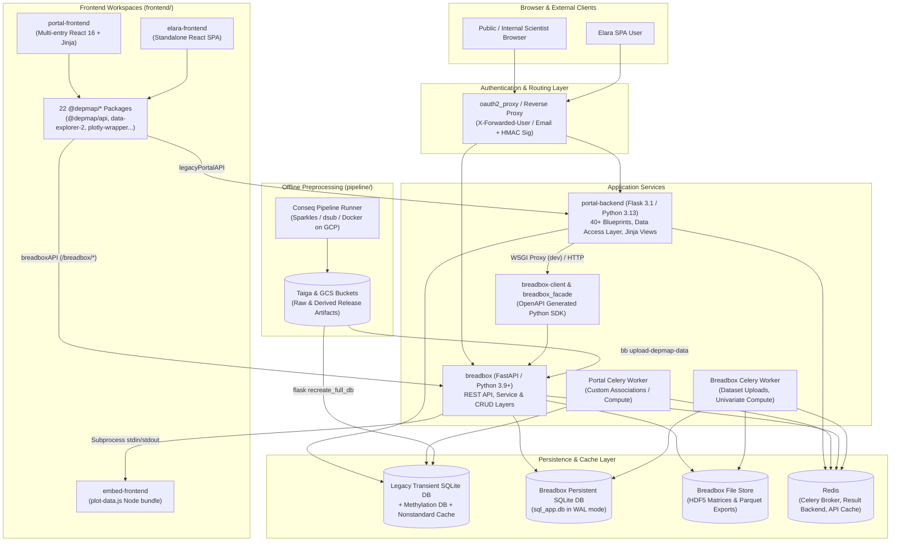
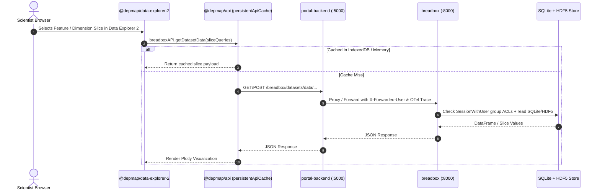
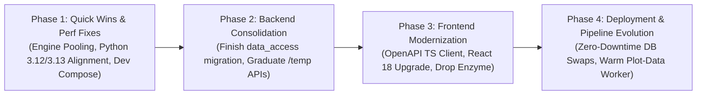

# DepMap Portal: System Design & Improvement Plan

This document provides:
1. **System Design & Architecture** of the `depmap-portal` monorepo as it exists today.
2. **Prioritized Improvement Plan** addressing architectural bottlenecks, technical debt, performance bugs, and developer experience across all services.

---

## Part 1: System Design & Architecture

### 1.1 High-Level Architecture Overview

The DepMap Portal is a hybrid monorepo undergoing a **Strangler-Fig migration** from a legacy monolithic Flask application ([`portal-backend/`](portal-backend)) with a transient deployment-rebuilt SQLite database toward a persistent, domain-driven FastAPI data service ([`breadbox/`](breadbox)) and modular React workspace packages ([`frontend/`](frontend)).

---

### 1.2 Core Subsystems & Responsibilities

| Subsystem | Tech Stack | Primary Responsibility | Key Entry Points |
| :--- | :--- | :--- | :--- |
| **Breadbox** ([`breadbox/`](breadbox)) | Python 3.9+, FastAPI 0.115, SQLAlchemy 2.0, Alembic, Celery 5.4, HDF5, APSW | Persistent storage and querying of **Matrix** (HDF5) and **Tabular** (SQLite) datasets, dimension metadata, release versions, CMS posts, and group-based row-level access control. | [`breadbox/breadbox/main.py`](breadbox/breadbox/main.py), [`breadbox/breadbox/startup.py`](breadbox/breadbox/startup.py), [`breadbox/breadbox/commands.py`](breadbox/breadbox/commands.py) |
| **Breadbox Client** ([`breadbox-client/`](breadbox-client)) | Python, `httpx`, `pandas`, `openapi-python-client` | Auto-generated OpenAPI bindings (`breadbox_client/`) + higher-level Pandas-aware wrapper (`breadbox_facade/client.py` `BBClient`). | [`breadbox-client/breadbox_facade/client.py`](breadbox-client/breadbox_facade/client.py) |
| **Portal Backend** ([`portal-backend/`](portal-backend)) | Python 3.13, Flask 3.1, SQLAlchemy 2.0, Celery 5.3, Gunicorn | Serves HTML shell templates, legacy biological entity pages (Gene, Compound, Cell Line, Context, Celligner, TDA), downloads metadata, and bridges legacy & Breadbox datasets via `depmap/data_access`. | [`portal-backend/depmap/app.py`](portal-backend/depmap/app.py), [`portal-backend/depmap/data_access/interface.py`](portal-backend/depmap/data_access/interface.py) |
| **Frontend Monorepo** ([`frontend/`](frontend)) | TypeScript 5.1, React 16.9, Yarn Workspaces, Webpack 5, SWC, Plotly.js, Bootstrap 3 | Houses `portal-frontend` (multi-entry React islands hydrated into Flask Jinja templates), `elara-frontend` (standalone Breadbox SPA), `embed-frontend` (headless Node bundle for `/temp/plot-data`), and 22 `@depmap/*` shared packages. | [`frontend/package.json`](frontend/package.json), [`frontend/packages/@depmap/api/src/createJsonClient.ts`](frontend/packages/@depmap/api/src/createJsonClient.ts) |
| **Preprocessing Pipeline** ([`pipeline/`](pipeline)) | Python, `conseq`, Docker, GCP (`dsub`, `sparkles`, GCS, Taiga) | Offline DAG execution that computes derived scientific datasets (e.g. LRT, TDA, predictability, correlations) and publishes artifacts to GCS and Taiga. | [`pipeline/pipeline_runner.py`](pipeline/pipeline_runner.py), [`pipeline/run.sh`](pipeline/run.sh) |
| **Native/Shared Helpers** | Cython (`packed-cor-tables`), Node (`smiles-to-svg`), TS/JSON (`depmap-shared`) | Fast compressed correlation table storage (`packed-cor-tables`), chemical structure rendering (`smiles-to-svg`), and shared schemas (`depmap-shared`). | [`packed-cor-tables/`](packed-cor-tables), [`smiles-to-svg/`](smiles-to-svg) |

---

### 1.3 Data Model & Storage Architecture

#### Breadbox 3-Layer & Hybrid Storage Design
Breadbox separates **relational metadata & tabular datasets** (in SQLite `sql_app.db` with Write-Ahead Logging enabled) from **dense numerical matrices** (stored as HDF5 files under `app_datasets/<dataset_id>/`).

- **Entity-Relationship Diagram**: [`breadbox/docs/ERD.png`](breadbox/docs/ERD.png)
- **Dataset & Dimension Indexing Model**: [`breadbox/docs/dataset_vis.png`](breadbox/docs/dataset_vis.png)

1. **Datasets (`Dataset` -> `MatrixDataset` | `TabularDataset`)**:
   - Identified by both an immutable `id` (UUID) and a stable human-readable `given_id` across releases.
   - **Tabular Datasets** store dimension metadata (`depmap_model`, `gene`, `compound`, etc.) in `TabularColumn` and `TabularCell` SQLite tables.
   - **Matrix Datasets** store feature/sample indices (`DatasetFeature`, `DatasetSample`) in SQLite and numerical arrays in HDF5 files accessed via `breadbox/io/`.
2. **Row-Level Access Control**:
   - **In Breadbox** ([`breadbox/breadbox/db/session.py`](breadbox/breadbox/db/session.py)): `SessionWithUser` overrides SQLAlchemy's `.query()` to inject `execution_options(filter_group_ids=self.get_read_group_ids())`. Unauthorized users outside a group receive `404` (preventing dataset existence leaks), while read-only group members attempting mutations receive `403`.
   - **In Legacy Portal Backend** ([`portal-backend/depmap/access_control/`](portal-backend/depmap/access_control)): Uses a custom SQLite user-defined function (`owned_by_is_visible`) evaluated per row against the current Flask request context's `owner_id`.

---

### 1.4 Request & Data Flow Sequences

#### Interactive Visualization & Plot Data Flow

---

## Part 2: Key Findings & Architectural Pain Points

During our audit of the codebase, we identified several concrete architectural and implementation bottlenecks:

> [!CAUTION]
> **Critical Performance Bug in Breadbox DB Session Management**
> In [`breadbox/breadbox/db/session.py`](breadbox/breadbox/db/session.py), `SessionLocalWithUser(user: str)` calls `create_engine(settings.sqlalchemy_database_url, ...)` **on every single request** instead of reusing a singleton SQLAlchemy `Engine` and `sessionmaker`. This discards connection pooling, repeatedly re-runs engine initialization and pragma setup, and adds avoidable latency and file-descriptor churn under concurrent load.

> [!WARNING]
> **Incomplete Backend Migration & Dual Access Control Models**
> - **Split Data Layer**: [`portal-backend/.importlinter`](portal-backend/.importlinter) documents unfinished migrations where `depmap.cell_line` and `depmap.interactive.nonstandard` still bypass `depmap.data_access` and call legacy `interactive_utils` directly.
> - **Growing `/temp` Namespace in Breadbox**: Production features (`associations`, `context`, `sql`, `predictive_models`, `plot-data`) live under `/temp/*` in Breadbox ([`breadbox-client/breadbox_facade/client.py`](breadbox-client/breadbox_facade/client.py)).
> - **Subprocess-per-request in `/temp/plot-data`**: Spawning a fresh Node child process (`node plot-data.js`) per call in Breadbox that calls back into Breadbox over loopback HTTP limits concurrency to `PLOT_DATA_MAX_CONCURRENCY=2`.

> [!IMPORTANT]
> **Frontend & Toolchain Debt**
> - **React 16.9 & Node OpenSSL Legacy Flag**: [`frontend/packages/portal-frontend/package.json`](frontend/packages/portal-frontend/package.json) is pinned to React `16.9.35` and `enzyme-adapter-react-16`, and CI ([`.github/workflows/build_app.yml`](.github/workflows/build_app.yml)) requires `NODE_OPTIONS='--openssl-legacy-provider'` and `diagnostics: false` in `ts-jest`.
> - **Manual Frontend API Sync**: While Python uses OpenAPI codegen (`./bb update-client`), TypeScript `breadboxAPI` in `frontend/packages/@depmap/api` is maintained by hand alongside `deprecatedBreadboxAPI.ts`.
> - **Python Version Drift**: `portal-backend` requires Python `^3.13` ([`portal-backend/pyproject.toml`](portal-backend/pyproject.toml)), while `breadbox` targets Python `^3.9` ([`breadbox/pyproject.toml`](breadbox/pyproject.toml)) with comments noting transitive security updates are blocked by Python 3.9 compatibility.

---

## Part 3: Phased Improvement Plan

### Phase 1: High-Impact Quick Wins & Reliability Fixes (1–2 Weeks)

1. **Fix SQLAlchemy Engine Instantiation in Breadbox**
   - **Target**: [`breadbox/breadbox/db/session.py`](breadbox/breadbox/db/session.py)
   - **Action**: Cache the `Engine` and `sessionmaker` at module/settings level (keyed on `settings.sqlalchemy_database_url` via `@lru_cache`) so `SessionLocalWithUser(user)` only instantiates a lightweight `SessionWithUser` from the cached `sessionmaker`.
2. **Align Python Runtime Across Services (`^3.12` / `^3.13`)**
   - **Target**: [`breadbox/pyproject.toml`](breadbox/pyproject.toml), [`breadbox-client/pyproject.toml`](breadbox-client/pyproject.toml)
   - **Action**: Upgrade Breadbox's Python floor from `^3.9` to `^3.12` (or `^3.13` to match `portal-backend`), unlocking blocked security updates noted in `breadbox/pyproject.toml` and upgrading `opentelemetry-instrumentation-*` so the `setuptools = "<81"` workaround can be removed in both backends.
3. **One-Command Local Development Orchestration**
   - **Target**: Root repository (`Makefile` / `Procfile.dev` or `docker-compose.dev.yml`)
   - **Action**: Replace the manual 6-terminal startup sequence (`redis-server`, `./bb run`, `./bb run_worker`, `./flask run`, `./flask run_dev_worker`, `yarn dev:portal`) with a single `make dev` / `overmind start -f Procfile.dev` command with health-check ordering.
4. **Decouple Local & PR Cross-Service Client Testing**
   - **Target**: [`portal-backend/pyproject.toml`](portal-backend/pyproject.toml), [`.github/workflows/build_app.yml`](.github/workflows/build_app.yml)
   - **Action**: Allow `portal-backend` to consume `../breadbox-client` directly in local dev and PR CI checks (or verify OpenAPI drift in CI when `breadbox/breadbox/api/**` or `breadbox/breadbox/schemas/**` changes).

---

### Phase 2: Backend Consolidation & Strangler-Fig Completion (3–6 Weeks)

1. **Complete `depmap.data_access` Layer & Enforce Import Linter Contracts**
   - **Target**: [`portal-backend/.importlinter`](portal-backend/.importlinter), [`portal-backend/depmap/data_access/`](portal-backend/depmap/data_access)
   - **Action**: Refactor `depmap.cell_line` and `depmap.interactive.nonstandard` to route all matrix/feature queries through `depmap.data_access` and uncomment the strict forbidden/layer rules in `.importlinter`.
2. **Graduate Breadbox `/temp/*` Endpoints into Versioned Core APIs**
   - **Target**: [`breadbox/breadbox/api/`](breadbox/breadbox/api), [`breadbox-client/breadbox_facade/client.py`](breadbox-client/breadbox_facade/client.py)
   - **Action**: Promote `/temp/associations`, `/temp/context`, `/temp/predictive_models`, and `/temp/plot-data` to stable, documented domain routers (`/associations`, `/contexts`, `/predictive-models`, `/plot-data`), keeping deprecated `/temp/*` aliases during transition.
3. **Enforce Strict 3-Layer Boundary in Breadbox (`API -> Service -> CRUD`)**
   - **Target**: [`breadbox/docs/architecture.md`](breadbox/docs/architecture.md), `breadbox/pyproject.toml`
   - **Action**: Add `import-linter` to `breadbox` to automatically enforce that `breadbox.api` never imports `breadbox.models` or `sqlalchemy` directly, and migrate remaining SQLAlchemy 1.x `.query()` calls in `breadbox/crud/` to SQLAlchemy 2.0 `select()` statements with a `do_orm_execute` session event hook for `filter_group_ids`.
4. **Replace Per-Request Node Subprocess in `/plot-data` with a Warm Worker or In-Process Service**
   - **Target**: `breadbox/breadbox/service/plot_data.py`, `frontend/packages/embed-frontend`
   - **Action**: Either keep a persistent long-lived Node worker pool communicating over Unix domain sockets / stdio, or port the slice-join logic of `plot-data.js` directly into a Python/Polars/DuckDB service inside Breadbox to eliminate loopback HTTP + V8 startup overhead.

---

### Phase 3: Frontend Modernization (4–8 Weeks)

1. **Auto-Generate TypeScript Breadbox Client from OpenAPI Spec**
   - **Target**: [`frontend/packages/@depmap/api/src/`](frontend/packages/@depmap/api/src)
   - **Action**: Add `openapi-typescript` / `openapi-fetch` (or `orval`) to `./bb update-client` so TypeScript types and `breadboxAPI` methods in `@depmap/api` are generated directly from Breadbox's OpenAPI schema, retiring `deprecatedBreadboxAPI.ts`.
2. **Upgrade React 16.9 to React 18 & Retire Enzyme**
   - **Target**: [`frontend/package.json`](frontend/package.json), [`frontend/packages/portal-frontend/package.json`](frontend/packages/portal-frontend/package.json)
   - **Action**:
     - Migrate remaining Enzyme tests to `@testing-library/react`.
     - Upgrade `react` and `react-dom` across workspaces from `16.9.x` to `18.3.x`.
     - Remove `NODE_OPTIONS='--openssl-legacy-provider'` from GitHub Actions and local build scripts.
3. **Consolidate Table Packages & Enable Incremental TypeScript Checks in CI**
   - **Target**: `frontend/packages/@depmap/{wide-table,long-table,slice-table,react-table}`
   - **Action**: Consolidate the 4 overlapping table packages around a single virtualized table primitive, and add `tsc --noEmit` to `run-frontend-tests` in [`.github/workflows/build_app.yml`](.github/workflows/build_app.yml) (since `ts-jest` currently runs with `diagnostics: false`).

---

### Phase 4: Deployment, Storage & Pipeline Evolution (Ongoing)

1. **Migrate Legacy Portal Transient Data to Breadbox / Parquet**
   - Continue moving remaining transient SQLite tables (Downloads metadata, Gene/Compound summary cards) into Breadbox so `flask recreate_full_db` and multi-GB SQLite directory swaps during Jenkins deployments can eventually be retired.
2. **Evaluate PostgreSQL / DuckDB for Breadbox Metadata & Analytical Queries**
   - While SQLite in WAL mode + HDF5 works well for single-node deployments, evaluating PostgreSQL for transactional metadata (`Group`, `Dataset`, `Dimension`) paired with DuckDB/Parquet for `/temp/sql` and flat-table subset queries will remove single-writer lock contention during large dataset uploads.
3. **Parallelize Breadbox CI & Add OpenAPI Contract Tests**
   - Apply `pytest-split` to [`.github/workflows/build_breadbox.yml`](.github/workflows/build_breadbox.yml) (matching `portal-backend`'s 5-way matrix split) and fail CI if `breadbox-client` is out of sync with Breadbox's OpenAPI schema.
